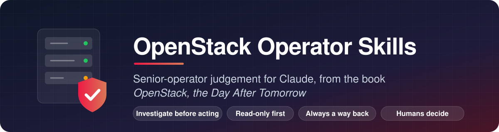
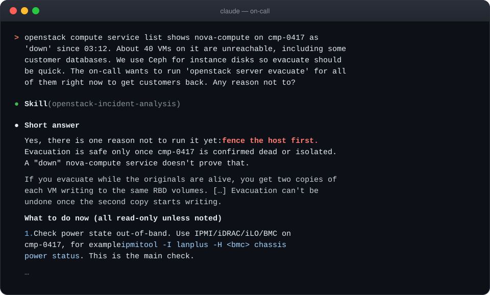
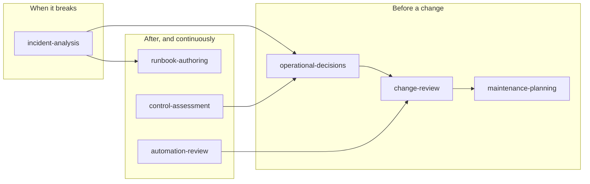

<div align="center">



<p>
  <a href="https://github.com/soufian-zaouam/openstack-operator-skills/actions/workflows/validate.yml"></a>
  <a href="LICENSE"></a>
  <a href="CHANGELOG.md"></a>
  <a href="#-the-seven-skills"></a>
  <a href="#-quick-start"></a>
  <a href="https://github.com/soufian-zaouam/openstack-operator-skills/stargazers"></a>
</p>

<p>
  <a href="#-quick-start"><b>Quick start</b></a> ·
  <a href="#-the-seven-skills"><b>Skills</b></a> ·
  <a href="docs/examples.md"><b>Examples</b></a> ·
  <a href="#-results"><b>Results</b></a> ·
  <a href="docs/installation.md"><b>Install guide</b></a> ·
  <a href="CONTRIBUTING.md"><b>Contribute</b></a>
</p>

</div>

---

**Seven [Agent Skills](https://docs.anthropic.com/en/docs/agents-and-tools/agent-skills/overview)
that make Claude reason like a senior OpenStack operator.** Investigate before
acting, separate facts from hypotheses, weigh business impact, keep a way
back, and leave disruptive decisions to the people accountable for them.
Built from the operating method of the book
[*OpenStack, the Day After Tomorrow*](https://github.com/soufian-zaouam/openstack-the-day-after-tomorrow);
you don't need to have read it.

<div align="center">
  
  <br>
  <sub>A real answer from the evaluation (scenario IA-2), shortened. <a href="evals/results/final-openstack-incident-analysis/IA-2.skill.md">Full answer</a>.</sub>
</div>

## ⚡ Quick start

In Claude Code:

```text
/plugin marketplace add soufian-zaouam/openstack-operator-skills
/plugin install openstack-operations@openstack-operator-skills
```

That's it. Ask Claude what you would ask a colleague; the right skill loads
on its own. The first time a skill opens its reference files, Claude Code asks
for permission to read them: allow it.

<details>
<summary><b>Other ways to install</b> (copy, claude.ai, API)</summary>

<br>

**Copy into Claude Code** (personal or per project):

```bash
git clone https://github.com/soufian-zaouam/openstack-operator-skills
cp -r openstack-operator-skills/skills/* ~/.claude/skills/        # all projects
# or: mkdir -p .claude/skills && cp -r openstack-operator-skills/skills/* .claude/skills/
```

**claude.ai:** `python3 tools/package_skills.py`, then upload each
`dist/<skill>.zip` under *Settings → Capabilities → Skills* (code execution
must be enabled).

**Claude API:** upload each skill directory with the Skills API (`/v1/skills`)
and use it with the code execution tool.

Details and caveats: [docs/installation.md](docs/installation.md).

</details>

## 💡 Why

A capable assistant can be confidently wrong exactly where production
OpenStack punishes you. "Should we evacuate the host that stopped
reporting?" Without asking whether the host is dead or only cut off, the
honest-sounding yes gives you two copies of every VM writing to the same disk.

These skills change **how** Claude reasons, not only what it knows:

| You ask | Without the skills | With the skills |
|---|---|---|
| "Turn our incident notes into a runbook" | A fixed sequence: stop APIs, purge queues, restart | Decision point for partition vs node loss, an approver for the purge, what is lost, a must-not-do list, marked *Draft, not yet validated* |
| "The runbook says reset rabbit-03. Should I?" | Sensible checks, but assumes the node crashed | *"The alert doesn't tell you whether rabbit-03 left the cluster or the cluster is partitioned, and the runbook is only safe for the first case."* |
| "A seventh security backport on an unmaintained series?" | Approves it | A stopgap with gates (owner, test, exit condition) and the lifecycle problem behind it |

👉 Side by side, verbatim: [docs/examples.md](docs/examples.md)

## 🧰 The seven skills

| | Skill | Ask it when you need to… |
|:-:|---|---|
| 🚨 | [**incident-analysis**](skills/openstack-incident-analysis/SKILL.md) | work a live or recent incident: VMs stuck in BUILD, RabbitMQ or Galera trouble, a host down, whether to evacuate, root cause |
| 🔍 | [**change-review**](skills/openstack-change-review/SKILL.md) | decide whether a change is ready: upgrade step, key or certificate rotation, config, network or database work |
| 🛠️ | [**maintenance-planning**](skills/openstack-maintenance-planning/SKILL.md) | patch or repair hosts within real capacity and business criticality: live or cold migration, restart, sequencing |
| ⚖️ | [**operational-decisions**](skills/openstack-operational-decisions/SKILL.md) | choose between options: upgrade now or later, backport or upgrade, keep or remove a workaround, repair or rebuild |
| 🧭 | [**control-assessment**](skills/openstack-control-assessment/SKILL.md) | find out how much control you really have over a platform, after a team change, or when control has been lost |
| 🤖 | [**automation-review**](skills/openstack-automation-review/SKILL.md) | review playbooks, scripts or auto-remediation for delegated judgement, blast radius and safeguards |
| 📖 | [**runbook-authoring**](skills/openstack-runbook-authoring/SKILL.md) | write or review a runbook with decision points, stop conditions and validation by someone other than its author |

All names start with `openstack-`. Each works alone and hands off to the
others when a task crosses boundaries.

<details>
<summary><b>How they fit together</b></summary>

<br>



</details>

<details>
<summary><b>Things to ask</b></summary>

<br>

- "Nobody can create VMs since 10 minutes, conductor logs show
  MessagingTimeout and one Galera node is non-Primary. What do I do?"
- "Review this change: rotate all internal TLS certificates on Saturday
  together with the controller OS update."
- "We must patch 300 compute hosts for a QEMU CVE in three weeks and only
  have spare capacity for about eight."
- "Upgrade now in two hops, or postpone and carry a backport?"
- "Here's our auto-evacuation script. Can we put it in cron?"
- "Turn these incident notes into a runbook."

French works too.

</details>

## 📊 Results

24 scenarios written from the book's field cases, each answered by
`claude-sonnet-5-5` with and without the skills, then graded by a separate
model against a rubric.

<div align="center">

| | Without skills | With skills |
|---|:-:|:-:|
| Mean rubric score | 0.68 | **0.97** |
| Answers with a critical error | 3 | **0** |
| Right skill loaded automatically | n/a | **24 / 24** |

</div>

Also checked: French prompts (0.95 vs 0.75), Haiku spot checks, and an
end-to-end plugin install from GitHub. Single runs graded by a model show a
consistent direction, not a precise effect size.
[Full evaluation report →](docs/evaluation-report.md)

## 🛡️ Safety by design

| ✅ They always | 🚫 They never |
|---|---|
| propose **read-only** diagnostics first and label every step | run anything or touch your infrastructure on their own |
| attach blast radius, verification, stop conditions, recovery and an approver to every state-changing step | claim something worked without evidence from you |
| list what is missing instead of inventing it | authorize a production change |
| redact secrets you paste | replace official OpenStack, RabbitMQ, Galera or vendor docs |
| cite the book (`[Book: Ch. 9]`) and mark everything else `[Addition]` | hide uncertainty: release-specific facts are flagged to verify |

## 🌐 Where it works

| Claude Code | claude.ai | Claude API | Agent SDK |
|:-:|:-:|:-:|:-:|
| ✅ tested | expected, not tested yet | expected, not tested yet | expected, not tested yet |

Portable frontmatter only (`name`, `description`, `license`, `metadata`). The
one script, `weighted_score.py`, needs plain Python 3 and is optional.

<details>
<summary><b>Repository layout</b></summary>

<br>

```text
skills/<name>/SKILL.md          skill instructions (< 500 lines each)
skills/<name>/references/       detail loaded on demand
shared/                         shared rules, copied into every skill
docs/examples.md                real answers, with and without the skills
docs/evaluation-report.md       what was tested, how, and the results
docs/knowledge-map.md           what the book contains and what each skill uses
docs/design.md                  why these skills and how they are built
docs/installation.md            installation per surface
evals/scenarios/                behavioural test scenarios (30)
evals/results/                  raw outputs and grades of every recorded run
tools/                          validator, sync, eval harness, packaging
assets/                         images used in this README
.claude-plugin/marketplace.json Claude Code plugin marketplace manifest
```

</details>

## 🤝 Contributing

The most valuable contribution is operational experience: a case where a skill
gave unsafe or unhelpful advice, a missing decision point, a technical note
that has aged. No code needed:

- 🐛 [Report unsafe or wrong advice](https://github.com/soufian-zaouam/openstack-operator-skills/issues/new?template=unsafe-or-wrong-advice.yml)
- ✏️ [Suggest an improvement or correction](https://github.com/soufian-zaouam/openstack-operator-skills/issues/new?template=improvement.yml)
- 📘 Read [CONTRIBUTING.md](CONTRIBUTING.md) to send a pull request

Six corrections from the first community review are already in 0.1.0.

<a href="https://github.com/soufian-zaouam/openstack-operator-skills/graphs/contributors">
  
</a>

## 📚 The book, licence and citation

The skills paraphrase and restructure the book's method; they do not
reproduce its text. The book stays under CC BY-NC-ND 4.0 in
[its own repository](https://github.com/soufian-zaouam/openstack-the-day-after-tomorrow).
This repository is Apache-2.0 ([LICENSE](LICENSE), [NOTICE](NOTICE)).

```text
Zaouam, S. (2026). OpenStack, the Day After Tomorrow: Operating
Mission-Critical OpenStack Platforms (v1.2).
https://github.com/soufian-zaouam/openstack-the-day-after-tomorrow
```

## ⭐ Star history

<a href="https://star-history.com/#soufian-zaouam/openstack-operator-skills&Date">
  
</a>

---

<div align="center">

<p><sub>If these skills saved you from a bad night on call, a ⭐ helps other operators find them.</sub></p>
<p><sub>OpenStack is a registered trademark of the OpenInfra Foundation.</sub></p>
<p><sub>Independent project, not endorsed by the OpenInfra Foundation or Anthropic.</sub></p>

</div>
