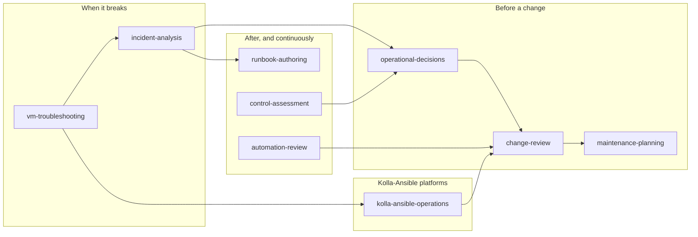

<div align="center">


<p>
  <a href="https://github.com/OzarLand/openstack-operator-skills/actions/workflows/validate.yml"></a>
  <a href="LICENSE"></a>
  <a href="CHANGELOG.md"></a>
  <a href="#-the-nine-skills"></a>
  <a href="#-quick-start"></a>
  <a href="https://github.com/OzarLand/openstack-operator-skills/stargazers"></a>
</p>

<p>
  <a href="#-quick-start"><b>Quick start</b></a> ·
  <a href="#-the-nine-skills"><b>Skills</b></a> ·
  <a href="#-validation-status"><b>Validation</b></a> ·
  <a href="docs/examples.md"><b>Examples</b></a> ·
  <a href="#-results"><b>Results</b></a> ·
  <a href="docs/installation.md"><b>Install guide</b></a> ·
  <a href="CONTRIBUTING.md"><b>Contribute</b></a>
</p>

</div>

---

**Nine [Agent Skills](https://docs.anthropic.com/en/docs/agents-and-tools/agent-skills/overview)
that make Claude reason like a senior OpenStack operator.** Investigate before
acting, separate facts from hypotheses, weigh business impact, keep a way
back, and leave disruptive decisions to the people accountable for them.
Built from the operating method of the book
[*OpenStack, the Day After Tomorrow*](https://github.com/soufian-zaouam/openstack-the-day-after-tomorrow)
and from the operational knowledge of the OzarLand
[VM runbooks](https://github.com/OzarLand/openstack-vm-runbooks) and
[Kolla-Ansible deployment patterns](https://github.com/OzarLand/kolla-ansible-deployment-patterns);
you don't need to have read them. Every procedure says how well it has been
validated: on a lab, in production, or not yet.

<div align="center">
  
  <br>
  <sub>A real answer from the evaluation (scenario IA-2), shortened. <a href="evals/results/final-openstack-incident-analysis/IA-2.skill.md">Full answer</a>.</sub>
</div>

## ⚡ Quick start

In Claude Code:

```text
/plugin marketplace add OzarLand/openstack-operator-skills
/plugin install openstack-operations@openstack-operator-skills
```

That's it. Ask Claude what you would ask a colleague; the right skill loads
on its own. The first time a skill opens its reference files, Claude Code asks
for permission to read them: allow it.

<details>
<summary><b>Other ways to install</b> (copy, claude.ai, API)</summary>

<br>

**Copy into Claude Code** (personal or per project):

```bash
git clone https://github.com/OzarLand/openstack-operator-skills
cp -r openstack-operator-skills/skills/* ~/.claude/skills/        # all projects
# or: mkdir -p .claude/skills && cp -r openstack-operator-skills/skills/* .claude/skills/
```

**claude.ai:** `python3 tools/package_skills.py`, then upload each
`dist/<skill>.zip` under *Settings → Capabilities → Skills* (code execution
must be enabled).

**Claude API:** upload each skill directory with the Skills API (`/v1/skills`)
and use it with the code execution tool.

Details and caveats: [docs/installation.md](docs/installation.md).

</details>

## 💡 Why

A capable assistant can be confidently wrong exactly where production
OpenStack punishes you. "Should we evacuate the host that stopped
reporting?" Without asking whether the host is dead or only cut off, the
honest-sounding yes gives you two copies of every VM writing to the same disk.

These skills change **how** Claude reasons, not only what it knows:

| You ask | Without the skills | With the skills |
|---|---|---|
| "Turn our incident notes into a runbook" | A fixed sequence: stop APIs, purge queues, restart | Decision point for partition vs node loss, an approver for the purge, what is lost, a must-not-do list, marked *Draft, not yet validated* |
| "The runbook says reset rabbit-03. Should I?" | Sensible checks, but assumes the node crashed | *"The alert doesn't tell you whether rabbit-03 left the cluster or the cluster is partitioned, and the runbook is only safe for the first case."* |
| "A seventh security backport on an unmaintained series?" | Approves it | A stopgap with gates (owner, test, exit condition) and the lifecycle problem behind it |

👉 Side by side, verbatim: [docs/examples.md](docs/examples.md)

## 🧰 The nine skills

| | Skill | Ask it when you need to… |
|:-:|---|---|
| 🚨 | [**incident-analysis**](skills/openstack-incident-analysis/SKILL.md) | work a live or recent incident: VMs stuck in BUILD, RabbitMQ or Galera trouble, a host down, whether to evacuate, root cause |
| 🔍 | [**change-review**](skills/openstack-change-review/SKILL.md) | decide whether a change is ready: upgrade step, key or certificate rotation, config, network or database work |
| 🛠️ | [**maintenance-planning**](skills/openstack-maintenance-planning/SKILL.md) | patch or repair hosts within real capacity and business criticality: live or cold migration, restart, sequencing |
| ⚖️ | [**operational-decisions**](skills/openstack-operational-decisions/SKILL.md) | choose between options: upgrade now or later, backport or upgrade, keep or remove a workaround, repair or rebuild |
| 🧭 | [**control-assessment**](skills/openstack-control-assessment/SKILL.md) | find out how much control you really have over a platform, after a team change, or when control has been lost |
| 🤖 | [**automation-review**](skills/openstack-automation-review/SKILL.md) | review playbooks, scripts or auto-remediation for delegated judgement, blast radius and safeguards |
| 📖 | [**runbook-authoring**](skills/openstack-runbook-authoring/SKILL.md) | write or review a runbook with decision points, stop conditions and validation by someone other than its author |
| 🖥️ | [**vm-troubleshooting**](skills/openstack-vm-troubleshooting/SKILL.md) | diagnose one instance, volume or port: stuck states, No valid host, no IP or metadata, port binding, volumes stuck attaching or deleting, OOM, host events |
| 🐳 | [**kolla-ansible-operations**](skills/openstack-kolla-ansible-operations/SKILL.md) | run, narrow and check `kolla-ansible` commands, read a failed run, add or replace hosts, MariaDB backup and recovery, secrets, design trade-offs (Kolla-Ansible only) |

All names start with `openstack-`. Each works alone and hands off to the
others when a task crosses boundaries.

<details>
<summary><b>How they fit together</b></summary>

<br>



</details>

<details>
<summary><b>Things to ask</b></summary>

<br>

- "Nobody can create VMs since 10 minutes, conductor logs show
  MessagingTimeout and one Galera node is non-Primary. What do I do?"
- "Review this change: rotate all internal TLS certificates on Saturday
  together with the controller OS update."
- "We must patch 300 compute hosts for a QEMU CVE in three weeks and only
  have spare capacity for about eight."
- "Upgrade now in two hops, or postpone and carry a backport?"
- "Here's our auto-evacuation script. Can we put it in cron?"
- "Turn these incident notes into a runbook."
- "This instance has been in deleting for an hour; can I reset its state?"
- "Which kolla-ansible command after changing nova.conf overrides, and what
  will it restart?"

French works too.

</details>

## 📊 Results

24 scenarios written from the book's field cases, each answered by
`claude-sonnet-5-5` with and without the skills, then graded by a separate
model against a rubric.

<div align="center">

| | Without skills | With skills |
|---|:-:|:-:|
| Mean rubric score | 0.68 | **0.97** |
| Answers with a critical error | 3 | **0** |
| Right skill loaded automatically | n/a | **24 / 24** |

</div>

Repeated three times on all 30 scenarios, including French prompts and
multi-turn conversations: 0.98 vs 0.73, and no critical error with the skills
in 90 answers (16 without). Also checked: Haiku triggering, an end-to-end
plugin install from GitHub, and the zips uploaded to claude.ai. Grading is by a model, so read it as a direction
more than an exact effect size. The two 0.2.0 skills, on 8 new scenarios: 0.96
with skills, 0.66 without, 8/8 loaded, no critical error with the skills (2
without); incident analysis still loads on all 6 of its scenarios. These runs
measure reasoning, not whether a procedure works on OpenStack.
[Full evaluation report →](docs/evaluation-report.md)

## 🔬 Validation status

This repository follows a strict technical validation policy
([docs/knowledge-validation-policy.md](docs/knowledge-validation-policy.md)).
Every procedure and technical claim an operator could act on carries a status
tag in the skill text and an entry in
[`validation/inventory.yaml`](validation/inventory.yaml), and Claude states
that status when it recommends the procedure:

| Status | Meaning |
|---|---|
| `PRODUCTION-VALIDATED` | executed and verified in a real production environment, documented |
| `LAB-VALIDATED` | executed and verified on a lab of the stated configuration, for the steps stated |
| `DOCUMENTED-UNVERIFIED` | from documentation, source code, the book or a runbook; no execution evidence |
| `PROPOSED-UNVERIFIED` | written here, not executed yet |
| `NEEDS-REVALIDATION` | was validated; the procedure or its context has changed |

**All procedures presented as validated in this knowledge base have been
successfully tested either in production or, at minimum, in a laboratory
environment. Procedures without sufficient execution evidence are explicitly
identified as unvalidated or experimental.** A lab result is never presented
as a production result, and reading or reviewing a procedure is not
validation.

In the terms commonly used for operational knowledge:

| Classification | Status used here |
|---|---|
| Production-validated | `PRODUCTION-VALIDATED` |
| Lab-validated | `LAB-VALIDATED`, for the steps and configuration recorded |
| Partially validated | each `LAB-VALIDATED` entry records the steps *not* observed; per skill, see the table below |
| Unvalidated | `DOCUMENTED-UNVERIFIED`: from documentation, the book or a runbook, never executed here |
| Experimental | `PROPOSED-UNVERIFIED`: written here, not executed |
| Possibly outdated | `NEEDS-REVALIDATION` |

**The knowledge base is undergoing validation.** It is not fully validated,
and no repository-wide validation claim will be made until every item in the
declared scope is production- or lab-validated. Current coverage, generated
from the inventory:

<!-- validation-coverage:start -->
163 of 352 items in scope (46 %) are validated: 0 in production, 163 in a lab. 189 are not validated yet.

| Status | Items | Share |
|---|---:|---:|
| `PRODUCTION-VALIDATED` | 0 | 0 % |
| `LAB-VALIDATED` | 163 | 46 % |
| `DOCUMENTED-UNVERIFIED` | 188 | 53 % |
| `PROPOSED-UNVERIFIED` | 1 | 0 % |
| `NEEDS-REVALIDATION` | 0 | 0 % |
| **Total in scope** | **352** | |

| Skill | Validation status | Environment | Software version | Evidence | Known limitations |
|---|---|---|---|---|---|
| `openstack-automation-review` | Unvalidated: 0 of 2 items | Unknown (no execution recorded) | Unknown (no execution recorded) | None recorded; [details](docs/validation-coverage.md) | All 2 items unverified |
| `openstack-change-review` | Unvalidated: 0 of 4 items | Unknown (no execution recorded) | Unknown (no execution recorded) | None recorded; [details](docs/validation-coverage.md) | All 4 items unverified |
| `openstack-control-assessment` | No inventory items: a reasoning method from the book | n/a | n/a | Behavioural evaluation only (reasoning, not execution) | Commands quoted in its examples are untagged, so unverified |
| `openstack-incident-analysis` | Partially lab-validated: 18 of 39 items | Kolla-Ansible labs | OpenStack 2026.1 | 18 lab records, 2026-10-13 to 2026-10-27; [details](docs/validation-coverage.md) | No production evidence; runs by an automated lab agent, no independent human check; 21 items unverified |
| `openstack-kolla-ansible-operations` | Partially lab-validated: 42 of 126 items | Kolla-Ansible labs | OpenStack 2025.1 to 2026.1, 2026.1 | 42 lab records, 2026-10-13 to 2026-10-27; [details](docs/validation-coverage.md) | No production evidence; runs by an automated lab agent, no independent human check; 84 items unverified |
| `openstack-maintenance-planning` | Partially lab-validated: 2 of 7 items | Kolla-Ansible labs | OpenStack 2026.1 | 2 lab records, 2026-10-24 to 2026-10-25; [details](docs/validation-coverage.md) | No production evidence; runs by an automated lab agent, no independent human check; 5 items unverified |
| `openstack-operational-decisions` | No inventory items: a reasoning method from the book | n/a | n/a | Behavioural evaluation only (reasoning, not execution) | Commands quoted in its examples are untagged, so unverified |
| `openstack-runbook-authoring` | No inventory items: a reasoning method from the book | n/a | n/a | Behavioural evaluation only (reasoning, not execution) | Commands quoted in its examples are untagged, so unverified |
| `openstack-vm-troubleshooting` | Partially lab-validated: 101 of 174 items | Kolla-Ansible labs | OpenStack 2026.1 | 101 lab records, 2026-10-13 to 2026-10-27; [details](docs/validation-coverage.md) | No production evidence; runs by an automated lab agent, no independent human check; 73 items unverified |
<!-- validation-coverage:end -->

What the lab evidence covers: OpenStack 2026.1 deployed with Kolla-Ansible
(mostly 22.x), Docker, Ubuntu 24.04, ML2/OVS, small nested labs (all-in-one,
or up to 3 controllers and 2 computes), RabbitMQ 4.2 with Khepri, Galera
behind ProxySQL. The runs were executed by an automated lab agent and
recorded in the OzarLand repositories; no human operator has independently
reproduced them yet, and this repository has not re-executed them. Nothing is
production-validated: the few production observations recorded are too thin
to qualify. OVN, Ceph, other releases and other deployment tools are mostly
untested. Per-item evidence and missing evidence:
[docs/validation-coverage.md](docs/validation-coverage.md).

Passing CI and the behavioural evaluations below say the bookkeeping is
consistent and that Claude reasons well; neither shows that an OpenStack
procedure works.

## 🛡️ Safety by design

| ✅ They always | 🚫 They never |
|---|---|
| propose **read-only** diagnostics first and label every step | run anything or touch your infrastructure on their own |
| attach blast radius, verification, stop conditions, recovery and an approver to every state-changing step | claim something worked without evidence from you |
| list what is missing instead of inventing it | authorize a production change |
| redact secrets you paste | replace official OpenStack, RabbitMQ, Galera or vendor docs |
| cite the book (`[Book: Ch. 9]`) and mark everything else `[Addition]` | hide uncertainty: release-specific facts are flagged to verify |
| state the validation status of each procedure, and what its lab run did not cover | present an untested procedure as tested, or a lab result as valid everywhere |

## 🌐 Where it works

| Claude Code | claude.ai | Claude API | Agent SDK |
|:-:|:-:|:-:|:-:|
| ✅ tested | ✅ tested | expected, not tested yet | expected, not tested yet |

Portable frontmatter only (`name`, `description`, `license`, `metadata`). The
one script, `weighted_score.py`, needs plain Python 3 and is optional.

<details>
<summary><b>Repository layout</b></summary>

<br>

```text
skills/<name>/SKILL.md          skill instructions (< 500 lines each)
skills/<name>/references/       detail loaded on demand
shared/                         shared rules, copied into every skill
validation/inventory.yaml       validation status and evidence of every procedure and claim
docs/knowledge-validation-policy.md  what "validated" means here, and how to contribute evidence
docs/validation-coverage.md     generated coverage report
docs/source-mapping.md          what came from the OzarLand repositories, and where it went
docs/examples.md                real answers, with and without the skills
docs/evaluation-report.md       what was tested, how, and the results
docs/knowledge-map.md           what the book contains and what each skill uses
docs/design.md                  why these skills and how they are built
docs/installation.md            installation per surface
evals/scenarios/                behavioural test scenarios (38)
evals/results/                  raw outputs and grades of every recorded run
tools/                          validators, sync, eval harness, packaging
assets/                         images used in this README
.claude-plugin/marketplace.json Claude Code plugin marketplace manifest
```

</details>

## 🏝️ Part of OzarLand

[OzarLand](https://github.com/OzarLand/ozarland) is an early-stage, independent
space where OpenStack operators share what they learn running it. This
repository is the AI-assisted part: the skills read the same knowledge that
operators can read directly, and keep its validation status attached.

| Repository | Role |
|---|---|
| [ozarland](https://github.com/OzarLand/ozarland) | Community home: principles, conventions, how pages are reviewed and validated |
| [openstack-vm-runbooks](https://github.com/OzarLand/openstack-vm-runbooks) | Symptom-driven runbooks for instance problems; source of most lab evidence here |
| [kolla-ansible-deployment-patterns](https://github.com/OzarLand/kolla-ansible-deployment-patterns) | Kolla-Ansible deployment choices and their trade-offs, compared rather than prescribed |
| [openstack-quick-lab](https://github.com/OzarLand/openstack-quick-lab) | A disposable lab to try OpenStack and practise the runbooks |
| openstack-operator-skills (here) | Claude skills that apply this knowledge and an operating method, and say how well each procedure was tested |

A correction to a procedure belongs first in the runbook or pattern it comes
from; the skill then picks it up ([docs/source-mapping.md](docs/source-mapping.md)).

## 🤝 Contributing

The most valuable contribution is operational experience: a case where a skill
gave unsafe or unhelpful advice, a missing decision point, a technical note
that has aged. No code needed:

- 🐛 [Report unsafe or wrong advice](https://github.com/OzarLand/openstack-operator-skills/issues/new?template=unsafe-or-wrong-advice.yml)
- ✏️ [Suggest an improvement or correction](https://github.com/OzarLand/openstack-operator-skills/issues/new?template=improvement.yml)
- 📘 Read [CONTRIBUTING.md](CONTRIBUTING.md) to send a pull request

Six corrections from the first community review are already in 0.1.0.

<a href="https://github.com/OzarLand/openstack-operator-skills/graphs/contributors">
  
</a>

## 📚 The book, licence and citation

The skills paraphrase and restructure the book's method; they do not
reproduce its text. The book stays under CC BY-NC-ND 4.0 in
[its own repository](https://github.com/soufian-zaouam/openstack-the-day-after-tomorrow).
This repository is Apache-2.0 ([LICENSE](LICENSE), [NOTICE](NOTICE)).

```text
Zaouam, S. (2026). OpenStack, the Day After Tomorrow: Operating
Mission-Critical OpenStack Platforms (v1.2).
https://github.com/soufian-zaouam/openstack-the-day-after-tomorrow
```

## ⭐ Star history

<a href="https://star-history.com/#OzarLand/openstack-operator-skills&Date">
  
</a>

---

<div align="center">

<p><sub>If these skills saved you from a bad night on call, a ⭐ helps other operators find them.</sub></p>
<p><sub>OpenStack is a registered trademark of the OpenInfra Foundation.</sub></p>
<p><sub>Independent project, not endorsed by the OpenInfra Foundation or Anthropic.</sub></p>

</div>
