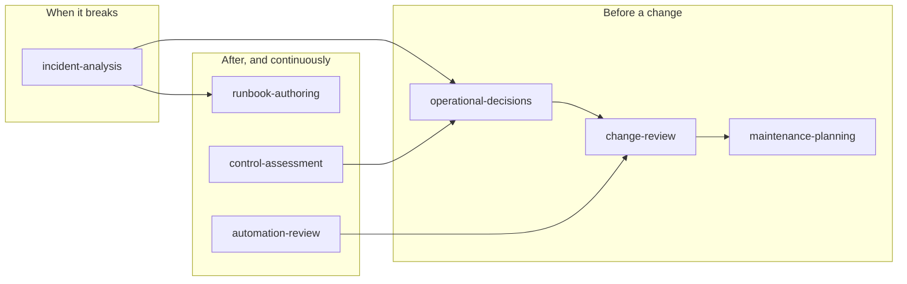

# OpenStack Operator Skills

[](https://github.com/soufian-zaouam/openstack-operator-skills/actions/workflows/validate.yml)
[](LICENSE)
[](#the-seven-skills)
[](#quick-start)
[](CHANGELOG.md)

**Give Claude the judgement of a senior OpenStack operator.**

Seven [Agent Skills](https://docs.anthropic.com/en/docs/agents-and-tools/agent-skills/overview)
that make Claude investigate before acting, separate facts from hypotheses,
weigh business impact, insist on a way back, and leave disruptive decisions to
the people accountable for them. They are built from the operating method of
the book
[*OpenStack, the Day After Tomorrow*](https://github.com/soufian-zaouam/openstack-the-day-after-tomorrow)
(Soufian Zaouam, v1.2). You do not need to have read it.

```text
/plugin marketplace add soufian-zaouam/openstack-operator-skills
/plugin install openstack-operations@openstack-operator-skills
```

---

## Why

A capable assistant can be confidently wrong in exactly the places where
production OpenStack punishes you. Ask it whether to run
`openstack server evacuate` on a host that stopped reporting, and it may say
yes, without asking whether the host is dead or only isolated. If it is
isolated, every instance now has two copies writing to the same disk.

These skills change how Claude reasons, not only what it knows:

| Without the skills | With the skills |
|---|---|
| Turns incident notes into "stop APIs, purge queues, restart RabbitMQ" as a fixed procedure | Adds the partition vs node-loss decision point, an approver for the purge, what is lost, a must-not-do list, and marks the runbook *Draft, not yet validated* |
| "The runbook says reset rabbit-03. Should I?" Sensible checks, but mostly assumes the node crashed | *"The alert doesn't tell you whether rabbit-03 left the cluster or the cluster is partitioned, and the runbook is only safe for the first case."* Then competing hypotheses and read-only checks on every node |
| "A seventh security backport on an unmaintained series?" Approves it | Treats it as a stopgap with gates: an owner, a test and an exit condition, and flags the lifecycle problem behind it |

These are real outputs from the evaluation runs: see
[docs/examples.md](docs/examples.md).

## Results at a glance

24 scenarios written from the book's field cases, each answered by
`claude-sonnet-5-5` with and without the skills, graded by a separate model
against a rubric ([full report](docs/evaluation-report.md)):

| | Without skills | With skills |
|---|---:|---:|
| Mean rubric score | 0.68 | **0.97** |
| Answers with a critical error (unsafe or wrong advice) | 3 | **0** |
| Right skill loaded automatically | n/a | **24 / 24** |

Also checked: French prompts (0.95 vs 0.75), Haiku spot checks, and an
end-to-end plugin install from GitHub. These are single runs graded by a
model: they show a consistent direction, not a precise effect size.

## The seven skills



| Skill | Ask it when you need to… |
|---|---|
| [`openstack-incident-analysis`](skills/openstack-incident-analysis/SKILL.md) | work a live or recent incident: VMs stuck in BUILD, RabbitMQ or Galera trouble, a host down, whether to evacuate, root cause |
| [`openstack-change-review`](skills/openstack-change-review/SKILL.md) | decide whether a change is ready: upgrade step, key or certificate rotation, config, network or database intervention |
| [`openstack-maintenance-planning`](skills/openstack-maintenance-planning/SKILL.md) | patch or repair hosts within real capacity and business criticality: live or cold migration, restart, sequencing |
| [`openstack-operational-decisions`](skills/openstack-operational-decisions/SKILL.md) | choose between options: upgrade now or later, backport or upgrade, keep or remove a workaround, repair or rebuild |
| [`openstack-control-assessment`](skills/openstack-control-assessment/SKILL.md) | find out how much control you really have over a platform, after a team change, or when control has been lost |
| [`openstack-automation-review`](skills/openstack-automation-review/SKILL.md) | review playbooks, scripts or auto-remediation for delegated judgement, blast radius and safeguards |
| [`openstack-runbook-authoring`](skills/openstack-runbook-authoring/SKILL.md) | write or review a runbook with decision points, stop conditions and validation by someone other than its author |

Each works on its own and hands off to the others when a task crosses
boundaries.

## Quick start

**Claude Code, as a plugin** (recommended):

```text
/plugin marketplace add soufian-zaouam/openstack-operator-skills
/plugin install openstack-operations@openstack-operator-skills
```

Then just talk to Claude:

> A compute node stopped reporting 20 minutes ago and its VMs are
> unreachable. My manager wants everything evacuated now. What do I do?

The first time a skill opens its reference files, Claude Code asks for
permission to read them: allow it.

Other ways to install (copy into `.claude/skills/`, claude.ai upload, Skills
API) are in [docs/installation.md](docs/installation.md).

### More things to ask

- "Nobody can create VMs since 10 minutes, conductor logs show
  MessagingTimeout and one Galera node is non-Primary. What do I do?"
- "Review this change: rotate all internal TLS certificates on Saturday
  together with the controller OS update."
- "We must patch 300 compute hosts for a QEMU CVE in three weeks and only
  have spare capacity for about eight."
- "Upgrade now in two hops, or postpone and carry a backport?"
- "Here's our auto-evacuation script. Can we put it in cron?"
- "Turn these incident notes into a runbook."

Prompts in French work too.

## What they do, and what they never do

**They do:**
- structure the reasoning: evidence ledger, dependency path, hypotheses with
  the check that would disprove each, gates, trade-offs, decision rights;
- propose **read-only** diagnostics first and label every step read-only or
  state-changing;
- attach prerequisites, blast radius, verification, stop conditions, recovery
  and an approving role to every state-changing step;
- list what is missing instead of inventing it, and redact secrets you paste;
- cite the book (`[Book: Ch. 9]`) so you can check the reasoning, and mark
  everything else as `[Addition]`.

**They never:**
- run anything or touch your infrastructure (unless you give Claude tools in
  your own session, and even then they start read-only);
- claim something worked without evidence from you;
- authorize a production change;
- replace the official OpenStack, RabbitMQ, Galera or vendor documentation:
  release-specific facts are flagged for you to verify.

## Where it works

| Surface | Status |
|---|---|
| Claude Code (CLI, `claude -p`, plugin) | Tested |
| claude.ai (zip upload) | Expected to work, not tested yet |
| Claude API (Skills API + code execution) | Expected to work, not tested yet |
| Agent SDK | Expected to work, not tested yet |

Only portable frontmatter is used (`name`, `description`, `license`,
`metadata`). The one script (`weighted_score.py`) needs plain Python 3 and is
optional.

## Repository layout

```text
skills/<name>/SKILL.md          skill instructions (< 500 lines each)
skills/<name>/references/       detail loaded on demand
shared/                         shared rules, copied into every skill
docs/examples.md                real outputs, with and without the skills
docs/evaluation-report.md       what was tested, how, and the results
docs/knowledge-map.md           what the book contains and what each skill uses
docs/design.md                  why these skills and how they are built
docs/installation.md            installation per surface
evals/scenarios/                behavioural test scenarios (28)
evals/results/                  raw outputs and grades of every recorded run
tools/                          validator, sync, eval harness, packaging
.claude-plugin/marketplace.json Claude Code plugin marketplace manifest
```

## Contributing

The most useful contribution is operational experience: a case where a skill
gave unsafe or unhelpful advice, a missing decision point, a technical note
that has aged. [Open an issue](https://github.com/soufian-zaouam/openstack-operator-skills/issues/new/choose)
or read [CONTRIBUTING.md](CONTRIBUTING.md). Six corrections from the first
community review are already in 0.1.0.

## The book, licence and citation

The skills paraphrase and restructure the book's method; they do not
reproduce its text. The book stays under CC BY-NC-ND 4.0 in
[its own repository](https://github.com/soufian-zaouam/openstack-the-day-after-tomorrow).
This repository is Apache-2.0 ([LICENSE](LICENSE), [NOTICE](NOTICE)).

> Zaouam, S. (2026). *OpenStack, the Day After Tomorrow: Operating
> Mission-Critical OpenStack Platforms* (v1.2).
> https://github.com/soufian-zaouam/openstack-the-day-after-tomorrow

*OpenStack is a registered trademark of the OpenInfra Foundation. This project
is independent of, and not endorsed by, the OpenInfra Foundation or
Anthropic.*
